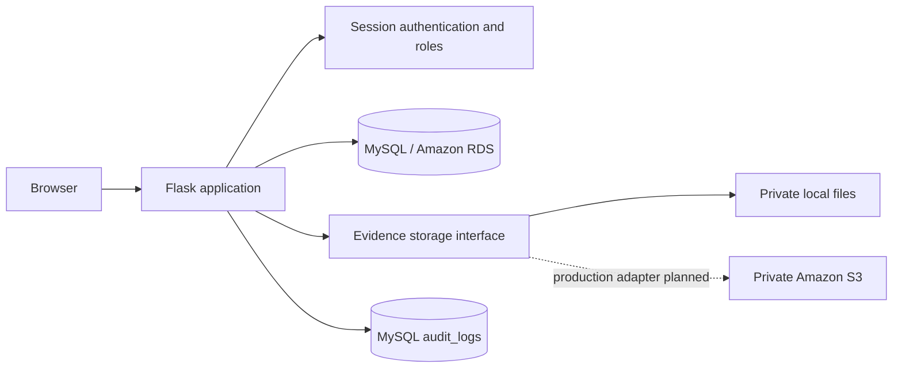

# CloudSentinel — Cloud Security Incident Tracker

CloudSentinel is a Flask application for recording, assigning, investigating, and auditing cloud security incidents. It is a college-project-friendly local application with a MySQL production-shaped schema, private local evidence storage, and an isolated SQLite test suite.

## Features

- Password-hashed sign-in, session authentication, analyst/admin roles, and administrator-managed user accounts.
- Database-backed dashboard counts, severity/status summaries, recent incidents, search, and filters.
- Source-attributed CISA KEV, NVD CVE, MITRE ATT&CK, and optional CIC-IDS2017 imports, kept separate from operational incident reports.
- Incident creation, update, assignment, status changes, response notes, and administrator-only deletion.
- Private evidence uploads with size/extension restrictions, random storage keys, checksums, and authenticated downloads.
- Administrator-only append-only application audit events.
- CSRF protection on browser forms, server-side validation, parameterized SQL, secure session defaults, and generic error pages.

## Architecture



Routes use the storage interface in `app.extensions["evidence_storage"]`; the included `LocalEvidenceStorage` is the development implementation. A private S3 implementation can supply the same `save`, `open`, and `delete` operations without changing incident routes. The application does not currently configure or access AWS services.

## Public cybersecurity data

Public vulnerability intelligence and operational incident reports are stored and displayed separately. An imported CVE is **not** evidence that CloudSentinel observed an attack or vulnerability in your cloud environment.

`schema.sql` adds `vulnerabilities`, `attack_objects`, `network_observations`, and `source_sync_state` with `CREATE TABLE IF NOT EXISTS`; it does not delete or replace users, incidents, or other existing data. After adding these tables, re-run the schema as a MySQL administrator. The runtime account needs only its existing `SELECT`, `INSERT`, `UPDATE`, and `DELETE` grants on `cloudsentinel.*`.

From `D:\CloudSentinel`, run the import command using the existing virtual environment:

```powershell
.\.venv\Scripts\python.exe import_public_data.py sync
```

It imports the official [CISA KEV JSON feed](https://www.cisa.gov/sites/default/files/feeds/known_exploited_vulnerabilities.json), [NVD CVE API](https://services.nvd.nist.gov/rest/json/cves/2.0), and MITRE's [Enterprise ATT&CK STIX data](https://attack.mitre.org/resources/attack-data-and-tools/). The first NVD run requests vulnerabilities modified in the prior seven days; subsequent runs use an overlapping incremental cursor. NVD requests paginate at 2,000 records and, without an optional `NVD_API_KEY` in `.env`, respect the public API's unauthenticated rate limit. Date windows are limited to 120 days; use `--nvd-since YYYY-MM-DDTHH:MM:SSZ` for a specific recent backfill window.

The ATT&CK feed is a full catalog download (approximately 53 MiB at the currently observed size). It is cached at `D:\CloudSentinel\data_cache\enterprise-attack.json`; the cache is Git-ignored. The importer enforces a 100 MiB download ceiling and prints the actual downloaded byte count. Run synchronization explicitly; no large feed is downloaded at application startup. CISA, NVD, and ATT&CK records are idempotently upserted by their source identifiers.

The optional network dataset is [CIC-IDS2017](https://www.unb.ca/cic/datasets/ids-2017.html), published by the Canadian Institute for Cybersecurity. Download the dataset from the institute's page yourself; its CSV archives are large (multiple gigabytes). The importer does not download them. Point it at one extracted CSV locally:

```powershell
.\.venv\Scripts\python.exe import_public_data.py import-cic --path 'D:\Datasets\CIC-IDS2017\Friday-WorkingHours-Afternoon-DDos.pcap_ISCX.csv'
```

Alternatively, set `CICIDS_CSV_PATH` in `.env` and run `.\.venv\Scripts\python.exe import_public_data.py import-cic`. Network records are benchmark observations from the dataset, not traffic captured from your infrastructure; benign/unlabeled records are excluded and duplicate rows are prevented on re-import.

An administrator can also use **Sync public sources** on the dashboard. The POST is protected by existing administrator authorization and CSRF protection. Each source's successful synchronization time is shown in the dashboard; failures do not advance its incremental cursor. The dashboard labels missing CVSS values as unknown and keeps public vulnerability statistics distinct from actual incident reports.

## Prerequisites

- Windows PowerShell and Python 3.11 or later (Python 3.13/3.14 supported by the selected dependencies).
- MySQL Server 8.x for local application use. MySQL Workbench is optional; the MySQL command-line client also works.
- The supplied `.venv` can be retained; use its interpreter for all Python commands.

MySQL Server 8.x and the MySQL command-line client are required for local application use. The application and tests do not require AWS credentials; login requires a reachable, initialized MySQL database.

## Install local MySQL Server (when approved)

The available package is the Oracle MySQL Server 8.4.9 64-bit MSI. Review Oracle's installer prompts and license before accepting. Installing a Windows service is a system change and may require an administrator/UAC approval; this PowerShell session is not elevated. Do not run the install command until you approve the installation. An interactive install command is:

```powershell
winget install --id Oracle.MySQL --exact --source winget --interactive
```

In the installer, configure MySQL Server as a Windows service, keep TCP networking enabled on port `3306` unless you intentionally choose another port, and set a strong unique MySQL `root` password. Save that password in a password manager; do not put it in a command line, script, or project file. MySQL Workbench is optional and is available as `Oracle.MySQLWorkbench`; it is not required if the MySQL command-line client is installed.

## Install in PowerShell

From `D:\CloudSentinel`:

```powershell
Set-Location D:\CloudSentinel
.\.venv\Scripts\python.exe -m pip install -r requirements.txt
if (-not (Test-Path .env)) { Copy-Item .env.example .env } else { Write-Output '.env exists; preserving it.' }
notepad .env
```

Edit the new `.env` locally, replacing every placeholder with a unique generated secret or the actual configured value. For a local server using the defaults, `DB_HOST=127.0.0.1`, `DB_PORT=3306`, `DB_NAME=cloudsentinel`, and `DB_USER=cloudsentinel` are appropriate. Set `DB_PASSWORD` to the application-account password you set in the SQL below. Generate a unique `FLASK_SECRET_KEY` and a separate initial administrator password; `ADMIN_PASSWORD` must contain 12–128 characters. Keep all actual secrets in `.env`/a password manager, never in terminal commands or output, and do not share or commit `.env`. If a `.env` already exists, preserve it and edit it locally; never replace it from `.env.example`.

The application uses:

| Variable | Purpose |
|---|---|
| `FLASK_SECRET_KEY` | Flask session signing key |
| `FLASK_DEBUG` | Development debug mode; keep `0` outside local development |
| `SESSION_COOKIE_SECURE` | Set `1` only when HTTPS is configured |
| `DB_HOST`, `DB_PORT`, `DB_NAME`, `DB_USER`, `DB_PASSWORD` | MySQL connection |
| `ADMIN_USERNAME`, `ADMIN_PASSWORD` | Initial administrator creation only |
| `UPLOAD_FOLDER` | Private local evidence directory |
| `MAX_CONTENT_LENGTH` | Maximum request/evidence size in bytes; default `10485760` |
| `PORT` | Local Flask port; default `5000` |

## Create the database and least-privilege account

Run SQL in **MySQL Workbench** connected as a local database administrator, or in the MySQL client. Do not paste SQL into PowerShell. The full `schema.sql` creates the `cloudsentinel` database and required tables. It uses `CREATE DATABASE/TABLE IF NOT EXISTS`, so it can be rerun without dropping data; it does not migrate existing tables.

In MySQL Workbench, open and execute `D:\CloudSentinel\schema.sql` using the MySQL `root` password you chose in the installer. Then execute this SQL separately as `root`, replacing the clearly marked password placeholder with a unique password from your password manager. Use a generated alphanumeric password of at least 32 characters so it needs no SQL quote escaping. Do not save the statement with the real password in a script or project file:

```sql
CREATE USER IF NOT EXISTS 'cloudsentinel'@'127.0.0.1' IDENTIFIED BY 'REPLACE_WITH_UNIQUE_ALPHANUMERIC_PASSWORD';
GRANT SELECT, INSERT, UPDATE, DELETE ON cloudsentinel.* TO 'cloudsentinel'@'127.0.0.1';
```

The application requires only `SELECT`, `INSERT`, `UPDATE`, and `DELETE` at runtime. The schema is created separately by the administrator, so the application account does not need database/table creation privileges. `CREATE USER IF NOT EXISTS` and `GRANT` are safe to rerun; if the account already exists, `IF NOT EXISTS` does not change its password. Keep that account's existing password in `.env` or deliberately rotate it through an administrator-managed password change and update `.env` to match. `FLUSH PRIVILEGES` is not needed for `CREATE USER`/`GRANT`.

For MySQL client users, from PowerShell the following sends the schema file to the client and prompts interactively for the administrator password (the password is not part of the command):

```powershell
Get-Content -Raw D:\CloudSentinel\schema.sql | mysql --default-character-set=utf8mb4 --host=127.0.0.1 --port=3306 --user=root --password
```

Run the account-creation/grant SQL above separately in Workbench or in an interactive `mysql --host=127.0.0.1 --port=3306 --user=root --password` session. The client must be installed and on `PATH`. Never run the application as MySQL `root`. If installing MySQL is not appropriate, configure `.env` with the actual reachable MySQL endpoint and credentials for a database you control; do not substitute a different database silently.

## Create the first administrator and start the app

Once `.env` contains database connection settings and `schema.sql` has been applied:

```powershell
Set-Location D:\CloudSentinel
.\.venv\Scripts\python.exe seed_admin.py
.\.venv\Scripts\python.exe app.py
```

`GET http://127.0.0.1:5000/health/database` returns `{"status":"ok"}` only when the configured database is reachable, all required tables exist, and the login query runs. Otherwise it returns a generic `503`; the server log records sanitized driver/error codes without connection details or credentials. After setup, verify this endpoint returns `200` and `{"status":"ok"}` before attempting sign-in.

Open **http://127.0.0.1:5000** and sign in with the administrator values you configured. The seed script creates an account only when its username is unused; it never silently resets an existing account. Administrators can create analyst accounts from **User management**.

The built-in Flask development server is intended only for local demonstration. Do not set `FLASK_DEBUG=1` on a public interface.

## Tests and checks

Tests use temporary SQLite databases and local temporary evidence directories; they do not connect to MySQL or AWS:

```powershell
.\.venv\Scripts\python.exe -m unittest discover -s tests -v
.\.venv\Scripts\python.exe -m compileall -q app.py seed_admin.py tests
```

## Demo workflow

1. Sign in as the initial administrator and create an analyst from **User management**.
2. Create a test incident with a category, resource, severity, detection time, and assigned analyst.
3. Open the incident, update its status and response notes, and attach a small `.txt` or `.log` file.
4. Sign in as the analyst to review incidents and evidence; verify the administrator audit and user pages are forbidden.
5. Sign back in as an administrator to review audit events and optionally delete the test incident.

Use synthetic data only. Uploaded evidence is stored privately on disk and can include sensitive incident material.

## Windows development / troubleshooting

- If `python` resolves to a different installation, invoke `.\.venv\Scripts\python.exe` as shown above.
- `Unable to reach the database` means to check that MySQL is running, `.env` connection values match, the database account can connect from this host, and the schema exists.
- `Could not initialize the administrator account` reports a connection/configuration issue without printing credentials. Ensure the MySQL user has `INSERT` permission.
- `MAX_CONTENT_LENGTH` is bytes and applies to the whole request, including multipart overhead.
- To generate a session secret without printing or saving it automatically, run `.\.venv\Scripts\python.exe -c "import secrets; print(secrets.token_hex(32))"` and paste the value into `.env` locally.
- Evidence cannot be served as static content; all downloads pass through an authenticated route.

See [AWS_DEPLOYMENT.md](AWS_DEPLOYMENT.md) for the production deployment plan and [PROJECT_STATUS.md](PROJECT_STATUS.md) for implementation and validation status.
